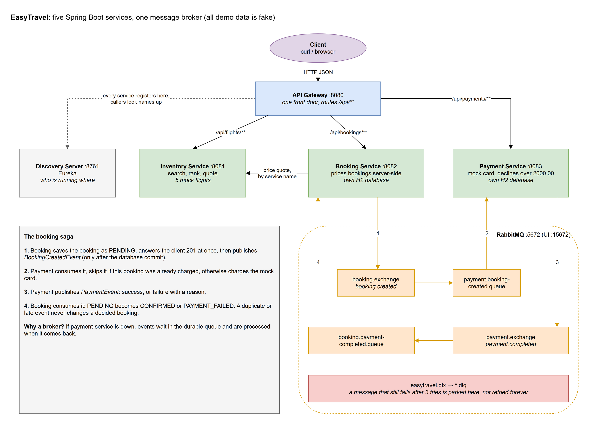
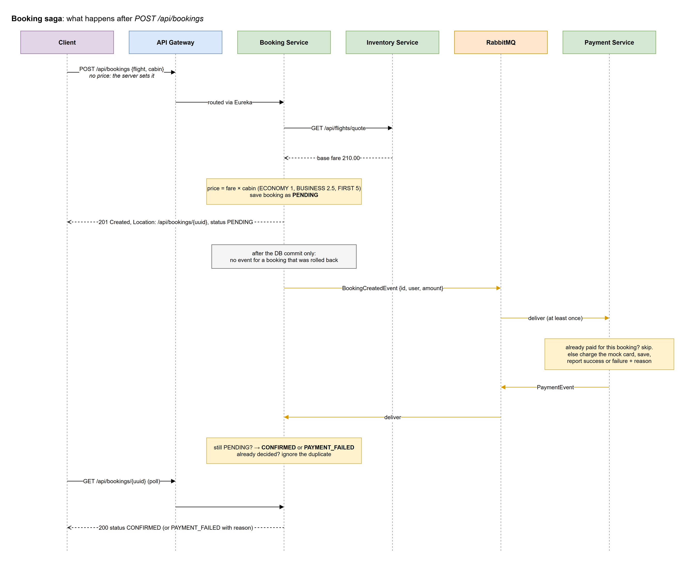

# EasyTravel

A flight-booking backend built as **Spring Boot microservices** to understand how services that cannot share a database still agree on one outcome: a booking is priced, paid for and confirmed across three services, connected by **RabbitMQ events**, with no lost or double-charged bookings when messages arrive twice or a service restarts.

> All data is fake: five mock flights and a mock card processor. No real payment is ever made.



## Overview

### What

Five services and a message broker, started with one `docker compose up`:

| Service | Port | Job |
|---|---|---|
| API Gateway | 8080 | the single front door; routes `/api/flights`, `/api/bookings`, `/api/payments` |
| Discovery Server | 8761 | Eureka: every service registers, callers look names up instead of hard-coding addresses |
| Inventory Service | 8081 | searches and ranks flights, and quotes the real price of one flight |
| Booking Service | 8082 | prices and stores bookings, and drives each one to CONFIRMED or PAYMENT_FAILED |
| Payment Service | 8083 | charges a mock card (declines anything over 2000.00) |
| RabbitMQ | 5672 / 15672 | carries the events between booking and payment, with dead-letter queues |

### Problem

A booking touches two services that each own their own database: booking-service stores the booking, payment-service stores the charge. There is no single transaction that covers both, so the usual ways of doing this go wrong:

1. **Calling payment over HTTP inside the booking request** couples them: if payment is slow or down, nobody can book.
2. **Fire-and-forget events** are lost or duplicated. Brokers deliver "at least once", so the same event can arrive twice, and a careless consumer **charges the customer twice**.
3. **Only reporting success** leaves a declined booking stuck as PENDING forever.
4. **Trusting the client** with the price lets anyone book a 1,050.00 first-class seat for 1.00.

### Solution

- **An event-driven saga.** `POST /api/bookings` saves the booking as PENDING and answers `201 Created` at once. payment-service consumes `BookingCreatedEvent`, charges, and replies with `PaymentEvent`, for **failure as well as success**. booking-service then moves the booking to CONFIRMED or PAYMENT_FAILED.
- **Publish only after commit** (`@TransactionalEventListener(AFTER_COMMIT)`): no event is ever sent for a booking that was rolled back.
- **Idempotent consumers, enforced twice:**
  - payment checks whether the booking was already charged, and `bookingId` is a unique column, so even two copies processed at the same moment cannot both be saved
  - booking only changes a booking that is still PENDING, so a duplicate or late event can never un-confirm a paid booking
  - `@Version` optimistic locking protects against two concurrent updates
- **UUID booking ids.** A counter restarts with an in-memory database, and a new "booking 1" would look like an already-paid one. UUIDs are never reused. (Found by restarting one service during testing; see [Edge cases](#edge-cases).)
- **Server-side pricing.** The request has no price field. booking-service asks inventory for the fare (`GET /api/flights/quote`) and applies the cabin multiplier: ECONOMY ×1, BUSINESS ×2.5, FIRST ×5.
- **Dead-letter queues.** A message that still fails after 3 tries goes to `*.dlq` for a human to inspect, instead of looping forever.
- **One error format everywhere:** 400 for bad input (listing every bad field), 404 for unknown things, 503 when a dependency is down. Never a 500 with a stack trace.

### The saga, step by step



### Why I built it

The first version had the services scaffolded but not talking to each other. I rebuilt it to learn the parts of backend Java that matter once there is more than one service:

| Concept | Where it lives |
|---|---|
| Service discovery and an API gateway | `discovery-server`, `api-gateway`, `@LoadBalanced RestClient` |
| Sagas and eventual consistency | `BookingService.createBooking` → `PaymentService.processBooking` → `BookingService.applyPaymentResult` |
| At-least-once delivery and idempotency | duplicate checks, unique `bookingId`, PENDING-only transitions, `@Version` |
| Transactional messaging | `BookingEventPublisher`, `PaymentEventPublisher` (after commit) |
| Failure handling | retries, dead-letter exchange `easytravel.dlx`, `GlobalExceptionHandler` |
| Not trusting the client | server-side pricing through `InventoryClient` |
| Containers | multi-stage `Dockerfile` (non-root), `docker-compose.yml` with a RabbitMQ health check |
| Testing | 30 JUnit 5 + Mockito tests, MockMvc for the HTTP contract |

## Setup

### Run everything with Docker (recommended)

Needs Docker Desktop. The images build the code themselves, so Java and Maven are not needed on the host.

```bash
docker compose up --build -d
```

Give it about a minute for the services to register with Eureka, then:

- API: http://localhost:8080
- Eureka dashboard: http://localhost:8761
- RabbitMQ UI: http://localhost:15672 (user `guest`, password `guest`, RabbitMQ's local-only default)

Stop it with:

```bash
docker compose down
```

### Build and test without Docker

Needs JDK 25 and Maven 3.9+.

```bash
mvn test
```

To run the services from the IDE instead, start only the broker with `docker compose up -d rabbitmq`, then start `DiscoveryServerApplication` first and the other four in any order.

## Usage

Search a route (ranked by a blend of price and duration):

```bash
curl "http://localhost:8080/api/flights/search?origin=LHR&destination=JFK"
```

Book an economy seat. Note that the `amount` the client tries to set is ignored:

```bash
curl -i -X POST http://localhost:8080/api/bookings -H "Content-Type: application/json" -d '{"userId":"alice","flightNumber":"BA249","origin":"LHR","destination":"JFK","fareClass":"ECONOMY","amount":1.00}'
```

```
HTTP/1.1 201 Created
Location: /api/bookings/f001f8cf-d8b7-4e00-ab7e-2aea61546425
{"id":"f001f8cf-...","flightNumber":"BA249","fareClass":"ECONOMY","price":210.00,"status":"PENDING",...}
```

Follow the `Location` a moment later. Payment has run:

```bash
curl http://localhost:8080/api/bookings/f001f8cf-d8b7-4e00-ab7e-2aea61546425
```

```
{"price":210.00,"status":"CONFIRMED","transactionId":"354a9ea9-...","failureReason":null,...}
```

A first-class seat on UA930 costs 420.00 × 5 = 2100.00, over the mock card's limit:

```bash
curl -X POST http://localhost:8080/api/bookings -H "Content-Type: application/json" -d '{"userId":"bob","flightNumber":"UA930","origin":"LHR","destination":"JFK","fareClass":"FIRST"}'
```

A moment later it reads `"status":"PAYMENT_FAILED","failureReason":"card limit of 2000.00 exceeded"`.

Other endpoints:

```bash
curl "http://localhost:8080/api/bookings?userId=alice"
```

```bash
curl "http://localhost:8080/api/payments?bookingId=f001f8cf-d8b7-4e00-ab7e-2aea61546425"
```

The demo flights (same five on every route):

| Flight | Fare | Duration |
|---|---|---|
| BA249 | 210.00 | 14h 30m |
| DL215 | 240.00 | 11h 00m |
| AA101 | 280.00 | 9h 15m |
| VS045 | 355.00 | 7h 45m |
| UA930 | 420.00 | 6h 30m |

## Edge cases

Every row was checked against the running stack or a unit test.

| Situation | What happens |
|---|---|
| Client sends its own price | Ignored; the field does not exist. The server prices the booking. |
| Unknown flight | 404 `flight ZZ999 from LHR to JFK not found`; nothing saved, no event. |
| Several bad fields | One 400 listing every field, e.g. `origin must be a 3-letter airport code, e.g. LHR`. |
| Unknown cabin, broken JSON | 400, never 500. |
| `/api/bookings/42` (not a UUID) | 400. A well-formed id that does not exist is 404. |
| Inventory is down | 503 with a clear message; no booking is saved. |
| Card declined | PAYMENT_FAILED with the reason. The old code left it PENDING forever. |
| Payment-service is down | Bookings stay PENDING; the events wait in the durable queue and are processed when it returns. |
| `BookingCreatedEvent` delivered twice | Charged once. The duplicate is logged and skipped. |
| `PaymentEvent` delivered twice, or a late contradicting one | Ignored; a decided booking never changes. |
| Event for a booking that does not exist | Retried 3 times, then parked in `booking.payment-completed.queue.dlq`. Tested by publishing a forged event from the RabbitMQ UI. |
| Booking-service restarted on its own | New bookings are still charged. Before UUID ids this broke: the in-memory id counter restarted at 1, payment saw "booking 1" as already paid, and the new booking stayed PENDING. |
| Database rolls back after the event is queued | Cannot happen: events are published only after the commit succeeds. |

## Limitations and next steps

- **Outbox pattern.** If a service crashes in the instant between committing and publishing, that one event is lost and the booking stays PENDING. The fix is to write the event to an outbox table in the same transaction and publish from there.
- **In-memory H2 databases** keep the demo self-contained; data is gone on restart. PostgreSQL per service would be the next step.
- **No authentication**: `userId` is trusted. Spring Security with JWTs at the gateway would fix that.
- **Polling**: clients poll the booking for its final status; WebSockets or server-sent events could push it instead.

## Project layout

```
common/             shared DTOs, events, exceptions and the error handler
discovery-server/   Eureka
api-gateway/        Spring Cloud Gateway routes
inventory-service/  flight search, ranking and quotes
booking-service/    bookings, pricing, both ends of the saga
payment-service/    mock card processor
docs/               diagrams (.drawio sources, PNGs, and the script that generates them)
```

## License

MIT, see [LICENSE](LICENSE).
